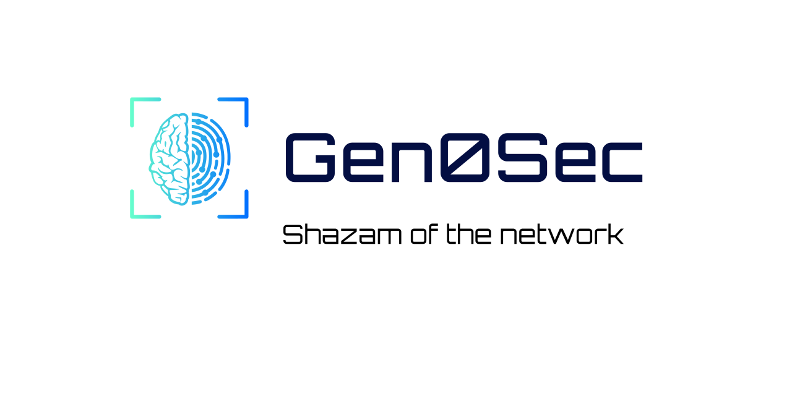

<p align="center">
  
</p>

<p align="center">
  <a href="https://github.com/gen0sec/helm-charts"></a> &nbsp;
  <a href="https://github.com/gen0sec/helm-charts/releases"></a> &nbsp;
  <a href="https://docs.gen0sec.com/"></a> &nbsp;
  <a href="https://discord.gg/jzsW5Q6s9q"></a> &nbsp;
  <a href="https://x.com/gen0sec"></a>
</p>

<p align="center">
  <a href="https://discord.gg/jzsW5Q6s9q"></a>
  <a href="https://gen0sec.substack.com/"></a>
</p>

---

## Gen0Sec Helm Charts

Helm charts for deploying the **Synapse** dataplane and its **Kubernetes operator**.

> Requires **Helm 3.8+ or Helm 4** (CI runs the latest Helm 4) and a conformant **Kubernetes** cluster. Published to `https://helm.gen0sec.com`.

---

## Charts

| Chart | Version | App | Purpose |
|---|---|---|---|
| [`synapse-stack`](charts/synapse-stack) | 0.12.4 | 0.8.3 | **Umbrella** — two `synapse` workloads from one release, aliased `proxy` and `agent`, plus the operator (`operator.enabled`, on by default) |
| [`synapse`](charts/synapse) | 0.10.2 | 0.8.3 | Synapse reverse proxy / dataplane. Optional `dragonfly` (`dragonfly.enabled`) and `cert-manager` (`cert-manager.enabled`) subcharts; optional ClamAV scanning (`clamavIntegration.enabled`) |
| [`synapse-operator`](charts/synapse-operator) | 1.6.0 | 0.1.11 | The Synapse Kubernetes operator (config-hash controller; optional ingress mode) |

`synapse-stack` deploys the **dataplane twice** from the same subchart, each alias getting its
own values tree and identity:

| Alias | Workload | Role | Condition |
|---|---|---|---|
| `proxy` | `synapse-proxy` | TLS passthrough / L7 / Tier-2 terminate | `proxy.enabled` |
| `agent` | `synapse-agent` | XDP transparent observe (edge only) | `agent.enabled` |

The stack also renders the operator from its own templates (`operator.enabled`, default `true`; set `operator.ingress.enabled` for the ingress-mode Deployment). Set `operator.enabled=false` to install it separately with the `synapse-operator` chart.

---

## Quick start

```bash
helm repo add gen0sec https://helm.gen0sec.com
helm repo update
helm search repo gen0sec        # list available charts + versions
```

**A single dataplane:**

```bash
helm install synapse gen0sec/synapse -n synapse --create-namespace
```

**Proxy and edge agent together, from the umbrella:**

```bash
helm install synapse-stack gen0sec/synapse-stack -n synapse --create-namespace
```

Both aliases default to enabled. Turn one off with `--set agent.enabled=false`, and set
per-alias values under the alias key — `--set proxy.service.type=LoadBalancer`, not
`--set service.type=...`.

**The operator on its own (separate release):**

```bash
helm install synapse-operator gen0sec/synapse-operator -n synapse-os --create-namespace
```

---

## What the operator does

The `synapse-operator` chart deploys the operator as a config-hash controller (its default mode, [source](https://github.com/gen0sec/synapse-operator)):

- Watches **ConfigMaps and Secrets** matching a label selector (default `app.kubernetes.io/name in (synapse,synapse-proxy,synapse-agent)`).
- Hashes their combined data and stamps the hash onto the Synapse workload under the `synapse.gen0sec.com/config-hash` annotation.
- A changed hash bumps the pod template, so Kubernetes **rolls the pods to pick up new config** — no manual restarts.

The chart wires these operator flags from `values.yaml` (top-level keys since 2.0.0; before that they sat under `operator:`):

| Value | Operator flag | Default |
|---|---|---|
| `leaderElect` | `--leader-elect` | `true` |
| `labelSelector` | `--label-selector` | `app.kubernetes.io/name in (synapse,synapse-proxy,synapse-agent)` |
| `configHashAnnotation` | `--config-hash-annotation` | `synapse.gen0sec.com/config-hash` |
| `ignoreConfigMapKeys` | `--ignore-configmap-keys` | `upstreams.yaml` |
| `ignoreSecretKeys` | `--ignore-secret-keys` | _(empty)_ |

The binary also has an Ingress + Gateway API mode. It is off by default; `operator.ingressMode=true` passes `--ingress-mode` and `operator.gatewayAPI=true` passes `--gateway-api` (and grants the matching RBAC). See [`values.yaml`](charts/synapse-operator/values.yaml) for the settings it needs.

---

## Configuration highlights

| Value | Chart | Notes |
|---|---|---|
| `service.type` | synapse | `ClusterIP` by default. Every Service port becomes a load balancer listener on `LoadBalancer` |
| `service.exposeHealth` | synapse | `false`. The health endpoint binds loopback in the container, so publishing its port routes nowhere — see below |
| `service.externalTrafficPolicy` | synapse | Unset (Kubernetes defaults to `Cluster`, which SNATs the client IP away). Set `Local` on a `LoadBalancer`/`NodePort` Service to preserve the real source address |
| `clamavIntegration.enabled` | synapse | Renders the in-chart ClamAV scanning templates (not a subchart) |
| `operator.image.repository` / `tag` | synapse-operator | `ghcr.io/gen0sec/synapse-operator`; an empty `tag` falls back to the chart's `appVersion` |

### Configuring the dataplane

`synapse.config` is a **block scalar** — the literal `config.yaml` the container reads, rendered
into a ConfigMap. It is not a structured values tree, so its contents cannot be reached with
`--set synapse.something`. To change the platform endpoint or key, edit that block:

```yaml
synapse:
  config: |
    platform:
      api_key: ""
      base_url: "https://api.gen0sec.com/v1"
```

The chart does not template an API-key Secret. Supply the key through the config block, or
override it at runtime with the container's `AX_`-prefixed environment variables.

### A note on the health port

`service.healthPort` (8080) names a **container** port. The health endpoint listens on loopback
inside the container, so nothing answers on the Pod IP there — which is why the default probes,
pointing at that port, have to be repointed at `httpPort` in practice.

Publishing it on the Service is therefore off by default. Enabling it on a `LoadBalancer`
service is the case to avoid: the cloud controller creates a listener for it and opens the load
balancer's security group to `0.0.0.0/0`, giving you an internet-facing port that accepts
nothing.

See each chart's `values.yaml` for the full set:
[`synapse`](charts/synapse/values.yaml) ·
[`synapse-operator`](charts/synapse-operator/values.yaml) ·
[`synapse-stack`](charts/synapse-stack/values.yaml)

---

## Releases

Charts are published to GitHub Pages (`https://helm.gen0sec.com`) by one workflow, [`release-charts.yaml`](.github/workflows/release-charts.yaml), using [chart-releaser](https://github.com/helm/chart-releaser-action) (config in `.cr.yaml`). Merging to `main` does not release anything; pushing a tag that matches `v*` does (or a manual `workflow_dispatch`).

1. Bump `version` in each changed chart's `Chart.yaml` and merge to `main`. The `Validate Charts` workflow requires the bump on every pull request that touches a chart.
2. Push a `v*` tag on a commit that is on `main`. The workflow fails if the tagged commit is not an ancestor of `origin/main`.
3. chart-releaser packages only the charts that changed since the previous tag (the latest tag reachable from the commit before the tagged one). `skip_existing` only stops it from re-uploading a version that already has a release; it does not make it look at unchanged charts.

If a release run fails part-way, re-run the workflow for the same tag: it looks at the same range again. Do not rely on the next release to pick it up: a new tag on a later commit packages only the charts changed since the failed tag, so a chart changed only before it is never published. To recover, land a change to the affected chart with a new `version` and tag again, or run chart-releaser (`cr package`, `cr upload`, `cr index`) by hand.

---

## Documentation

| | |
|---|---|
| [Gen0Sec Docs](https://docs.gen0sec.com/) | Product documentation and guides |
| [synapse](https://github.com/gen0sec/synapse) | The Synapse dataplane this chart deploys |
| [synapse-operator](https://github.com/gen0sec/synapse-operator) | The operator source and full flag reference |

---

## License

These charts are distributed under the **Apache-2.0** license — see [`LICENSE`](LICENSE).
